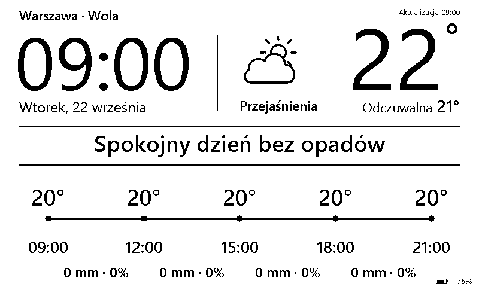

# Pogodynka C Studio

Domowy panel pogodowy na czarno-białym ekranie e-paper 7,5″ (800 × 480), zbudowany na LaskaKit ESPink v3.6. Firmware w wersji 2.0.1. Pokazuje zegar, bieżące warunki, wykres temperatury i opadów oraz krótkie podsumowanie po polsku.



## Jak działa

- Prognoza z Open-Meteo odświeża się domyślnie co 15 minut. Przy problemach z siecią panel zachowuje ostatnie dane i sygnalizuje ich przedawnienie.
- Zegar aktualizuje się częściowo co minutę. Pełne odświeżenie następuje przy zmianie treści i okresowo po godzinie.
- ESP32-S3 przechodzi w deep sleep pomiędzy cyklami. Panel pokazuje szacowany poziom naładowania i ogranicza odświeżanie przy niskim napięciu.
- Opcjonalny klucz Tomorrow.io włącza krótkoterminową prognozę opadów. Podstawowa prognoza działa z samym Open-Meteo.

## Sprzęt

- LaskaKit ESPink v3.6 z ESP32-S3, 16 MB Flash i 8 MB PSRAM.
- Czarno-biały panel 7,5″ klasy T7, 800 × 480. Firmware używa sterownika GxEPD2_750_T7. W użytym zestawie DIP wyświetlacza jest ustawiony na 1 ON i 2 OFF.
- Antena Wi-Fi, przewód USB do programowania oraz opcjonalnie akumulator 1S 3,7 V zgodny z płytką.
- Modele ramki i pokrywy znajdują się w [katalogu hardware](hardware/README.md).

| Sygnał ekranu | GPIO |
| --- | ---: |
| CS | 10 |
| SCK | 12 |
| MOSI | 11 |
| DC | 48 |
| RST | 45 |
| BUSY | 38 |
| Zasilanie ekranu | 47 |

Dokumentacja płytki i ustawień DIP znajduje się w [repozytorium producenta](https://github.com/LaskaKit/ESPink#dip-switch-positions).

## Uruchomienie

1. Skopiuj [wifi.h.example](PanelESPink/secrets/wifi.h.example) jako `PanelESPink/secrets/wifi.h` i uzupełnij nazwę oraz hasło Wi-Fi.
2. Ustaw szerokość i długość geograficzną (`LOC_LAT`, `LOC_LON`) oraz strefę czasową (`TZ_INFO`) w [config.h](PanelESPink/config.h). Domyślnie ustawiono centrum Warszawy, polską strefę czasową i DHCP.
3. Jeśli korzystasz z Tomorrow.io, skopiuj [tomorrow_key.h.example](PanelESPink/secrets/tomorrow_key.h.example) jako `PanelESPink/secrets/tomorrow_key.h` i wpisz klucz. Oba nagłówki konfiguracyjne są ignorowane przez Git. Wgrany firmware zawiera wprowadzone dane Wi-Fi i klucz API, dlatego plik binarny z własną konfiguracją zachowaj lokalnie.
4. Zainstaluj zależności, skompiluj szkic i wgraj go na swój port szeregowy.

Komendy Arduino CLI do uruchomienia z katalogu głównego repozytorium:

```sh
arduino-cli core update-index --additional-urls https://espressif.github.io/arduino-esp32/package_esp32_index.json
arduino-cli core install --additional-urls https://espressif.github.io/arduino-esp32/package_esp32_index.json esp32:esp32@3.2.0
arduino-cli lib install "ArduinoJson@7.4.1" "GxEPD2@1.6.9" "Adafruit GFX Library@1.12.6" "Adafruit BusIO@1.17.4"
arduino-cli compile --fqbn esp32:esp32:esp32s3:FlashSize=16M,PartitionScheme=app3M_fat9M_16MB,PSRAM=opi,CDCOnBoot=default PanelESPink
arduino-cli upload --port COM5 --fqbn esp32:esp32:esp32s3:FlashSize=16M,PartitionScheme=app3M_fat9M_16MB,PSRAM=opi,CDCOnBoot=default PanelESPink
```

W poleceniu wgrywania zamień `COM5` na port swojego urządzenia. W Arduino IDE otwórz [PanelESPink.ino](PanelESPink/PanelESPink.ino) i wybierz ESP32S3 Dev Module, Flash 16 MB, partycję 3 MB APP / 9,9 MB FATFS (`app3M_fat9M_16MB`), OPI PSRAM i wyłączone USB CDC On Boot. Monitor szeregowy ustaw na 460800 baud.

W przypadku błędu linkera związanego z przecinkiem w ścieżce przenieś kopię repozytorium do katalogu o prostej nazwie, np. `C:/projekty/pogodynka-e-paper`.

## Zasoby i podgląd

Gotowe bitmapy są częścią szkicu. Python jest potrzebny tylko do narzędzi pomocniczych.

```sh
python -m pip install -r tools/requirements.txt
python tools/ikony_contour_bw.py
python PanelESPink/generuj_dekoracje.py
```

Aby zapisać obraz z urządzenia, ustaw `DEBUG_FB_DUMP` na `1`, wgraj firmware i uruchom `python tools/podglad.py --port COM5 --out build/podglad.png` po utworzeniu katalogu `build`. Podaj własny port.

Dane pogodowe pochodzą z [Open-Meteo](https://open-meteo.com/) oraz opcjonalnie z [Tomorrow.io](https://www.tomorrow.io/weather-api/). Glify w firmware powstały z kroju Inter, objętego [SIL Open Font License 1.1](licenses/Inter-OFL.txt).
