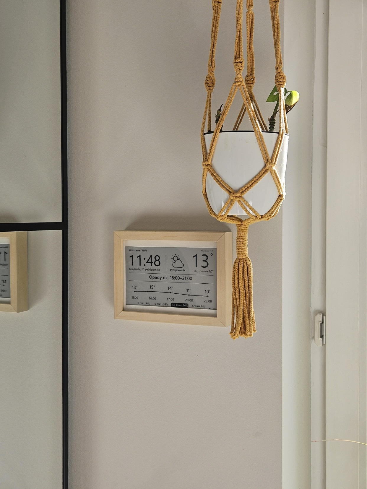
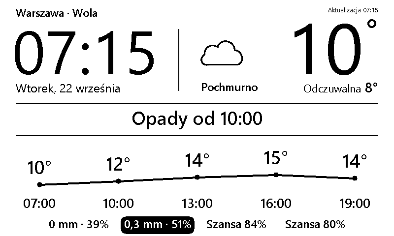
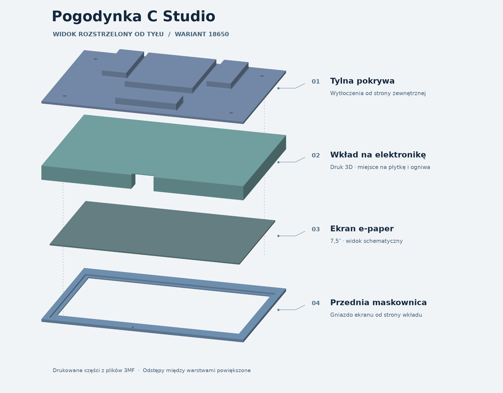

# Pogodynka C Studio

**Domowy panel pogodowy w drewnianej ramce**

7,5″ e-paper · 800 × 480 px · ESP32-S3 · zasilanie akumulatorowe

[Interfejs](#interfejs) · [Budowa i modele 3D](#budowa-i-modele-3d) · [Uruchomienie](#uruchomienie)

Pogoda na dziś, godzina i informacja o tym, kiedy spodziewać się deszczu. Panel jest zaprojektowany do czytania z drugiego końca pokoju. Na ekranie są duże cyfry, wykres i jedno krótkie podsumowanie po polsku.

## Interfejs

Przykład z symulatora. Temperatura rośnie z 10 do 15°C. O 10:00 prognoza pokazuje 0,3 mm opadu i 51% szansy, a dla kolejnych godzin ekran podaje samą szansę opadów.

| Na ekranie | Jak działa |
| --- | --- |
| Zegar i data | Zegar odświeża się częściowo co minutę. |
| Temperatura i opady | Open-Meteo dostarcza dane domyślnie co 15 minut. |
| Podsumowanie dnia | Krótki opis po polsku. Opcjonalnie Tomorrow.io podpowiada, kiedy może zacząć padać. |
| Poziom baterii | ESP32-S3 przechodzi w deep sleep pomiędzy cyklami i ogranicza aktualizacje przy niskim napięciu. |

## Budowa i modele 3D

[Obróć złożenie w podglądzie 3D](hardware/zlozenie-18650-v2.stl) · STL poglądowy. Pliki do druku są w tabeli poniżej.

Trzy drukowane elementy mieszczą się w drewnianej ramce. Maskownica otacza ekran, wkład mieści płytkę LaskaKit ESPink v3.6 i pakiet trzech ogniw 18650 po 3000 mAh, a tylna pokrywa zamyka całość. Ilustracja powstała z plików 3MF. Ekran jest pokazany schematycznie.

| Część | Plik |
| --- | --- |
| Maskownica | [3MF](hardware/pasportu.3mf) · [STEP](hardware/pasportu.step) |
| Wkład wariantu 18650 | [3MF](hardware/pasportu_18650.3mf) |
| Tylna pokrywa | [3MF](hardware/pokrywa_tylna.3mf) |
| Alternatywny docisk | [3MF](hardware/pasportu_docisk.3mf) |

[Zdjęcia wnętrza i tylnej pokrywy](hardware/README.md)

## Uruchomienie

1. Otwórz szkic [PanelESPink.ino](PanelESPink/PanelESPink.ino) w Arduino IDE lub użyj Arduino CLI.
2. Skopiuj [przykładową konfigurację Wi-Fi](PanelESPink/secrets/wifi.h.example) jako `PanelESPink/secrets/wifi.h` i wpisz dane swojej sieci.
3. Ustaw lokalizację w [config.h](PanelESPink/config.h), skompiluj szkic i wgraj go na płytkę.

[Pełna instrukcja z pinami, zależnościami i poleceniami](docs/uruchomienie.md)

## Licencje i autorzy

- **Firmware i narzędzia projektu** są udostępnione na [GPL-3.0-only](LICENSE). Licencja pozwala także na użycie komercyjne. Przy dystrybucji firmware obowiązują jej warunki, w tym udostępnienie odpowiadającego kodu źródłowego.
- **Modele 3D** można bezpłatnie pobrać, dostosować i wydrukować na własny użytek niekomercyjny. Użycie komercyjne wymaga pisemnej zgody autora. [Warunki korzystania z modeli](hardware/LICENSE.md).
- Sterownik ekranu rozszerza GxEPD2 Jeana-Marca Zingga. Adaptacja zmienia sekwencję pełnego odświeżania, w tym sterowanie VCOM i opcjonalny booster. [GxEPD2](https://github.com/ZinggJM/GxEPD2).
- Wcześniejszy układ interfejsu był inspirowany projektem Luke'a Marzena. [esp32-weather-epd](https://github.com/lmarzen/esp32-weather-epd).
- Komponenty zewnętrzne zachowują własne licencje. Dotyczy to m.in. glifów Inter, których licencja jest dołączona w katalogu `licenses/`. [SIL Open Font License 1.1](licenses/Inter-OFL.txt).
