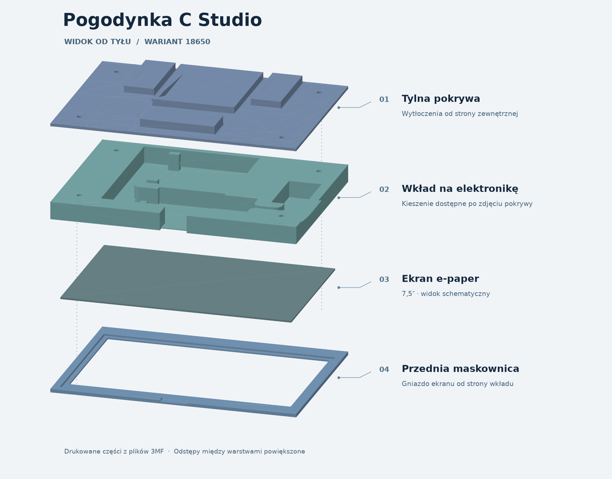
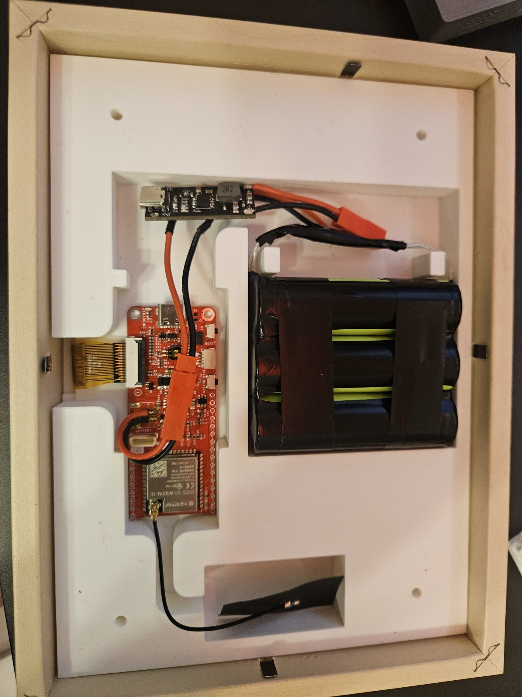
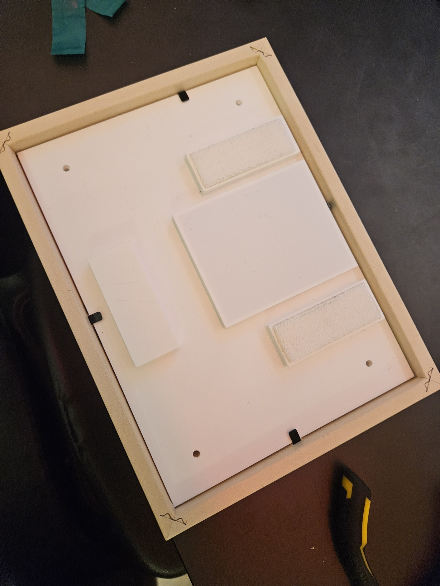

# Ramka do panelu 7,5″

[← Powrót do projektu](../README.md)

[Obróć złożenie w podglądzie 3D](zlozenie-18650.stl) · STL poglądowy. Pliki do druku są w tabeli poniżej.

| Plik | Element |
| --- | --- |
| [pasportu.3mf](pasportu.3mf) | Przednia maskownica wyświetlacza |
| [pasportu.step](pasportu.step) | Edytowalny eksport STEP maskownicy |
| [pasportu_docisk.3mf](pasportu_docisk.3mf) | Docisk wyświetlacza |
| [pasportu_18650.3mf](pasportu_18650.3mf) | Wkład na elektronikę i ogniwa 18650 |
| [pokrywa_tylna.3mf](pokrywa_tylna.3mf) | Tylna pokrywa |

Modele 3MF można otworzyć w slicerze i przygotować dla własnej drukarki. Przed wydrukiem sprawdź dopasowanie do wymiarów swojej ramki i panelu.

[Warunki korzystania z modeli 3D](LICENSE.md).

## Zdjęcia z montażu

W drewnianej ramce zamontowano drukowaną maskownicę, LaskaKit ESPink, antenę Wi-Fi, trzy ogniwa 18650 po 3000 mAh i osobny moduł ładowania USB-C.

Wnętrze ramki przed założeniem pokrywy.

Tył ramki po założeniu pokrywy.
